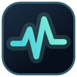

  
  <h1>Sada</h1>
  
<strong>Audio-reactive desktop scenes and synced lyrics for Windows.</strong>

  
Build a desktop scene around your music with album artwork, lyrics, and transparent widgets.

  

    <a href="https://github.com/Abood03/Sada/releases/latest"><strong>Download for Windows x64</strong></a>
    · <a href="docs/quick-start.md">Quick start</a>
    · <a href="docs/features.md">Feature explorer</a>
    · <a href="docs/architecture.md">System map</a>
    · <a href="docs/roadmap.md">Roadmap</a>
  

## Get started

1. Download the Windows x64 ZIP from [Latest release](https://github.com/Abood03/Sada/releases/latest), extract it, and run `Sada.exe`. The portable package includes the .NET runtime.
2. Play a song in Spotify or open a music video on YouTube. Sada reads playback through Windows. For YouTube, select it under **Media & lyrics → Playback source**.
3. Select **Edit desktop scene** to try **Album**, **Karaoke**, or **Focus**. Drag and resize the widgets, then use **Save** to apply the scene.

## Explore the features

<strong>Desktop scenes and the visualizer</strong>

Arrange transparent widgets on your desktop, place album artwork in the center of Ring or Halo, and match the visualizer palette to the cover. Save layouts for different displays and switch between them from the system tray.

[Desktop scenes](docs/features.md#desktop-scenes) · [Visualizer controls](docs/features.md#visualizer) · [Every widget](docs/features.md#widget-catalog)

<strong>Spotify, YouTube, and synchronized lyrics</strong>

Sada follows the active Windows media session and can fetch lyrics by track metadata. Follow the current line with surrounding lines in view. The optional Chrome and Edge extension supplies playback time and video identity for YouTube watch pages.

[Playback sources](docs/features.md#playback-sources) · [Lyrics display](docs/features.md#synchronized-lyrics) · [Set up YouTube](docs/youtube.md)

<strong>Lyrics Studio and per-recording timing</strong>

Tap a line as you hear it, adjust individual word boundaries, or shift an entire recording in 0.10-second steps. Preview the timing and save it for that exact recording.

[Edit and restore timing](docs/features.md#lyrics-studio)

<strong>Neon Sign and full screen</strong>

Show the current track as illuminated tubing. The title follows the album artwork, the glow cuts out when playback pauses, and the tubes relight progressively when playback resumes.

[Neon controls](docs/neon-and-motion.md) · [Full-screen controls](docs/features.md#full-screen)

## Documentation

| I want to… | Start here |
| --- | --- |
| Install Sada, see lyrics, or make my first scene | [Quick start](docs/quick-start.md) |
| Find a control or browse all desktop widgets | [Feature explorer](docs/features.md) |
| See how playback, audio, lyrics, and widgets connect | [System map](docs/architecture.md) |
| Build Sada from source or run the checks | [Build and package](docs/build.md) · [Testing](docs/testing.md) |
| See what shipped and what could come next | [Changelog](CHANGELOG.md) · [Roadmap](docs/roadmap.md) |
| Understand local data and bundled dependencies | [Local data and network requests](docs/architecture.md#local-data-and-network-requests) · [Third-party notices](THIRD-PARTY-NOTICES.md) |

The portable build has been tested on Windows 11. Settings, listening history, and timing edits are stored under `%LOCALAPPDATA%\Sada`.
