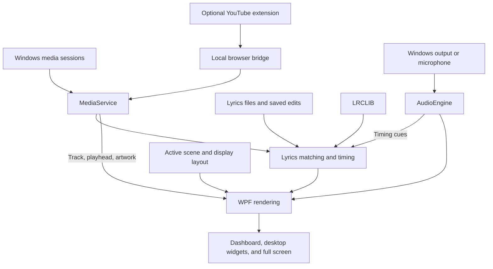

# System map

[Home](../README.md) · [Features](features.md) · [Roadmap](roadmap.md) · [Testing](testing.md)

Sada is a Windows desktop application built with C#, .NET 10, and WPF. The portable release targets `win-x64`. Playback metadata and sound arrive through independent paths, so the visualizer can respond to Windows audio even when the player does not expose track details.

| Follow this path | Open the code |
| --- | --- |
| **Start-up and settings** load the active scene, manage the tray and dashboard, and refresh media, audio, and widgets. | [App.xaml.cs](../App.xaml.cs), [Dashboard.cs](../Dashboard.cs), [Preferences.cs](../Preferences.cs) |
| **Scene editing** previews a draft, aligns widgets, and persists positions relative to the selected display. | [SceneEditor.cs](../SceneEditor.cs), [ScenePreview.cs](../ScenePreview.cs), [SceneLayout.cs](../SceneLayout.cs) |
| **Playback** reads track metadata, cover art, position, and supported controls through Windows media sessions. The optional browser bridge provides a YouTube video ID and playhead. | [MediaService.cs](../MediaService.cs), [App.YouTube.cs](../App.YouTube.cs), [YouTubeBridge.cs](../YouTubeBridge.cs), [YouTubeTrack.cs](../YouTubeTrack.cs) |
| **Audio** samples the output or selected microphone. The audio frame supplies level, spectrum and beat data. Output cues can also inform adaptive lyric timing. | [AudioEngine.cs](../AudioEngine.cs), [SongSync.cs](../SongSync.cs) |
| **Lyrics** loads a provider or local file, estimates missing word timings, and displays the result. Lyrics Studio manages recording-specific edits. | [MediaService.cs](../MediaService.cs), [App.LyricsStudio.cs](../App.LyricsStudio.cs), [LyricRecording.cs](../LyricRecording.cs), [LyricsStudio.cs](../LyricsStudio.cs), [LyricFlow.cs](../LyricFlow.cs), [LyricText.cs](../LyricText.cs) |
| **Widgets and full screen** render audio, cover palettes, text, and desktop effects. Neon Sign and Glitch Box each save a separate full-screen position within the active scene. | [DesktopInterop.cs](../DesktopInterop.cs), [DesktopWidget.cs](../DesktopWidget.cs), [WidgetView.cs](../WidgetView.cs), [Visualizer.cs](../Visualizer.cs), [AlbumPalette.cs](../AlbumPalette.cs), [EnvironmentView.cs](../EnvironmentView.cs), [Extras.cs](../Extras.cs), [NeonSign.cs](../NeonSign.cs), [GlitchBox.cs](../GlitchBox.cs), [FullWidgetOverlay.cs](../FullWidgetOverlay.cs) |
| **Utility widgets** read local system usage, storage, the calendar, listening history, and weather. | [DesktopData.cs](../DesktopData.cs) |

How lyric timing is selected

1. An edit saved in **Lyrics Studio** takes priority for its recording. With the browser extension, the YouTube video ID identifies the recording. Other playback uses the reported source, artist, title, album, and duration.
2. Sada otherwise uses the chosen local lyrics file or looks up lyrics through LRCLIB when automatic lyrics are enabled. Timed LRC, Enhanced LRC, and Lyricsfile YAML can carry authored timings. With line timings alone, Sada estimates word intervals.
3. A saved per-song offset controls playback when a full studio edit is unavailable. Optional adaptive timing adjusts the display only after consistent output cues. It is off for YouTube and microphone capture.
4. The renderer uses the selected playhead and timings to fill the text progressively. Lyrics Studio labels which timings came from the source, were estimated, or were edited.

How the YouTube extension connects

The optional Chrome and Edge extension reads state on YouTube watch pages. It sends video metadata, timing, and playback state through Native Messaging to the registered `Sada.exe` host. That host relays to the running app over a current-user Windows named pipe. The app can also use the Windows media session reported by the browser. [YouTube setup](youtube.md)

## Local data and network requests

| Location or service | Data it handles |
| --- | --- |
| `%LOCALAPPDATA%\Sada\settings.json` | Scenes, profiles, preferences, simple timing offsets, and manual YouTube song matches. |
| `%LOCALAPPDATA%\Sada\recording-timings\` | Lyrics Studio corrections stored in JSON files keyed by recording identity. |
| `%LOCALAPPDATA%\Sada\listening-history.json` | Local listening history used by the Listening stats widget. |
| `%LOCALAPPDATA%\Sada\com.sada.youtube.json` | Manifest created when the browser bridge is registered. It points to the current executable. Chrome and Edge read it through current-user registry entries. |
| **LRCLIB** | Lyrics lookup may send the title, artist, album, and duration. |
| **Open-Meteo** | Weather lookup sends a city search, then retrieves a forecast for the coordinates returned by the search. |

Sound analysis runs locally. Sada reads Spotify playback from Windows without requiring Spotify credentials inside the app. The portable build and installed copies of the same Windows user share the local data directory.

## Technology

| Layer | Stack |
| --- | --- |
| App and rendering | C#, .NET 10, WPF/XAML, and Windows Forms for the tray and screen information. [Project settings](../Sada.csproj) |
| Desktop integration | Win32 and DWM for transparency, placement, and input behavior. Windows Global System Media Transport Controls for metadata and supported transport commands. |
| Audio and lyrics | NAudio.Wasapi 2.2.1 for WASAPI capture, YamlDotNet 18.1.0 for Lyricsfile parsing, and .NET JSON and HTTP libraries for storage and requests. [Third-party notices](../THIRD-PARTY-NOTICES.md) |
