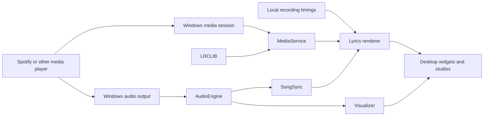

# بنية صدى

التطبيق مكتبي بلغة C#، ويستهدف `net10.0-windows10.0.19041.0` في المشروع. بناء الإصدار المحمول يستهدف `win-x64`.

## التقنية ودورها

| التقنية | الاستخدام في صدى |
| --- | --- |
| C# و‎.NET 10 وWPF/XAML | نوافذ التطبيق، الواجهات، الرسم، وعرض الكلمات. [WPF](https://learn.microsoft.com/en-us/dotnet/desktop-wpf/overview/index) |
| Windows Forms | أيقونة وقوائم شريط النظام، والوصول لمعلومات الشاشات. |
| Win32 وDWM | وضع النوافذ الشفافة على سطح المكتب، وتمرير النقرات، وتحديد مواضع العناصر مع اختلاف الشاشات وDPI. |
| Windows `GlobalSystemMediaTransportControlsSession` | قراءة الأغنية والفنان والألبوم والصورة ووقت التشغيل، وإرسال الأوامر التي تدعمها جلسة الوسائط. لا يتطلب صدى تسجيل الدخول إلى حساب Spotify من داخل التطبيق. [Windows Media Control](https://learn.microsoft.com/en-us/uwp/api/windows.media.control.globalsystemmediatransportcontrolssession) |
| `NAudio.Wasapi` **2.2.1** | التقاط صوت مخرج ويندوز محليًا عبر WASAPI loopback، أو الميكروفون عند اختياره. تُحسب شدة الصوت والطيف لتحريك المؤثرات، ويستخدم `SongSync` إشارة الصوت في المطابقة التقديرية. [NAudio](https://github.com/naudio/NAudio) |
| `YamlDotNet` **18.1.0** | قراءة مستندات Lyricsfile بصيغة YAML. [YamlDotNet](https://github.com/aaubry/YamlDotNet) |
| `System.Text.Json` و`HttpClient` | قراءة وكتابة الإعدادات والتوقيت المحلي وإجراء طلبات خدمات الكلمات والطقس. |
| LRCLIB | جلب الكلمات بالنص والتوقيت المتاح عبر بيانات الأغنية. [توثيق LRCLIB](https://lrclib.net/docs) |
| Open-Meteo | البحث عن المدينة وجلب الطقس للودجت الاختياري. [البحث عن المواقع](https://open-meteo.com/en/docs/geocoding-api) · [توقعات الطقس](https://open-meteo.com/en/docs) |

## قراءة الكود

| الجزء | الملفات الرئيسية |
| --- | --- |
| دورة التطبيق وإدارة النوافذ والمشاهد | `App.xaml.cs`، `Dashboard.cs`، `Preferences.cs` |
| تحرير المشهد والمعاينة والمحاذاة | `SceneEditor.cs`، `ScenePreview.cs`، `SceneLayout.cs` |
| عناصر سطح المكتب والرسم والألوان | `DesktopWidget.cs`، `DesktopInterop.cs`، `WidgetView.cs`، `Visualizer.cs`، `AlbumPalette.cs`، `EnvironmentView.cs`، `Extras.cs` |
| الصوت وبيانات الأغاني ومطابقة التوقيت | `AudioEngine.cs`، `MediaService.cs`، `SongSync.cs` |
| تنسيق الكلمات وتعديل التوقيت | `LyricFlow.cs`، `LyricText.cs`، `LyricsStudio.cs`، `LyricRecording.cs`، `App.LyricsStudio.cs` |
| الطقس وبيانات النظام واستخدام الوسائط | `DesktopData.cs` |

تسبق التعديلات المحفوظة للتسجيل التوقيت التلقائي. يطابق التطبيق التسجيل باستخدام مصدر التشغيل والفنان والعنوان والألبوم والمدة التي يبلغ عنها ويندوز. عند غياب توقيت الكلمات من المصدر، يقدّر التطبيق مددها ضمن توقيت السطر. المطابقة التلقائية من الصوت تحتاج دلائل متّسقة قبل تعديل التوقيت، وتظل التعديلات اليدوية متاحة من المحرّر.

## البيانات المحلية والاتصال

- يحفظ التطبيق `settings.json` و`listening-history.json` وملفات `recording-timings/*.json` تحت `%LOCALAPPDATA%\Sada`. الحزمة المحمولة تستخدم نفس مجلد البيانات المحلي للإصدارات السابقة.
- ترسل ميزة جلب الكلمات بيانات الأغنية مثل العنوان والفنان والألبوم والمدة إلى LRCLIB. عند استخدام الطقس، يرسل صدى اسم المدينة إلى خدمة البحث من Open-Meteo، ثم إحداثيات النتيجة إلى خدمة التوقعات.
- يُعالَج الصوت محليًا. نسخة المستودع وحزمة الإصدار لا تشمل إعدادات المستخدم أو سجل الاستماع أو توقيتاته، ولا تتضمن ملفات أغاني أو كلمات أو صور أغلفة.
